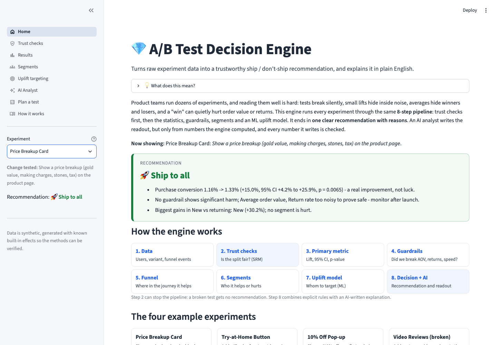
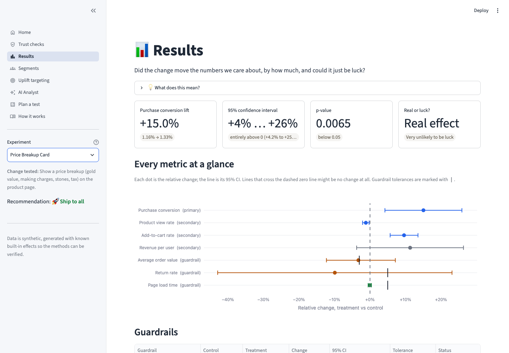
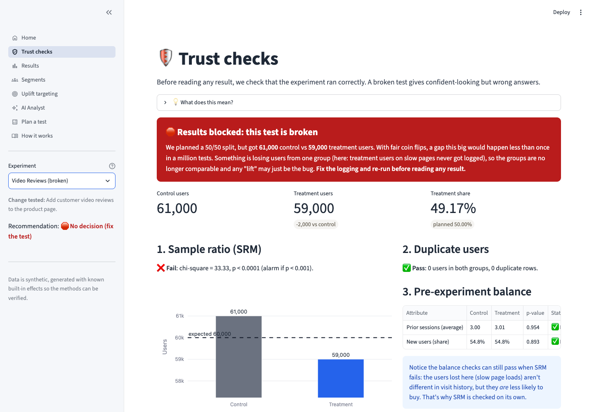
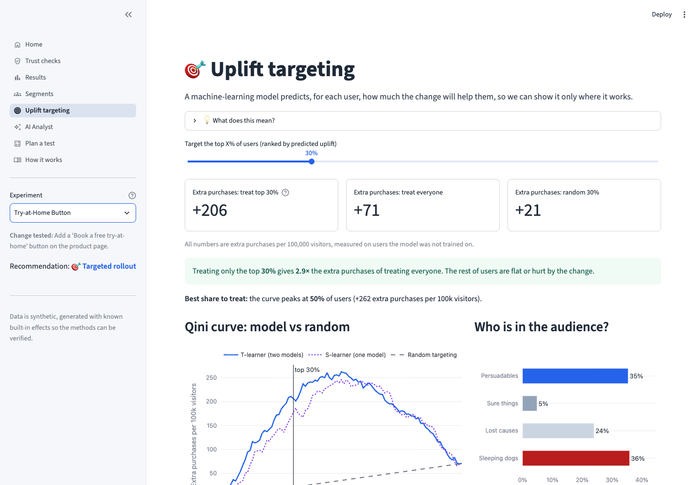

# 💎 A/B Test Decision Engine

**A product experimentation tool that turns raw A/B test data into a trustworthy "ship / don't ship" recommendation, and explains it in plain English.**

You give it an experiment (who saw which version, and what they did). It checks whether the test ran correctly, measures the effect and how sure we can be, checks nothing important got broken, finds which users the change helps or hurts, trains a machine-learning model to decide whom to target, and ends with one clear recommendation plus reasons. An AI analyst writes the readout, but it is only allowed to use numbers the engine computed, and every number it writes is checked automatically.

🔗 **Live demo:** `<add your Streamlit Community Cloud URL here>`

> The data is **synthetic and generated with known built-in effects so the methods can be verified**. For example, the Price Breakup experiment was planted at +15% purchase lift, and the engine measures +15.0%.

---

## Screenshots

| Home & recommendation | Results |
|---|---|
|  |  |
| **Trust checks (broken test blocked)** | **Uplift targeting** |
|  |  |

---

## The four example experiments

All are set in an online jewellery store, ~120,000 users each, 14 days, 50/50 split.

| Experiment | What changed | What it demonstrates | Engine's decision |
|---|---|---|---|
| **Price Breakup Card** | Show gold value, making charges, stones and tax on the product page | A clear winner: purchases 1.16% → 1.33% (**+15.0%**, 95% CI +4.2% to +25.9%, p = 0.0065); biggest gain among new users; no guardrail harmed | 🚀 **Ship to all** |
| **Try-at-Home Button** | "Book a free try-at-home" button | Flat on average (+5.4%, p = 0.29) but a **hidden winner**: high-price-band (+72.7%) and tier-1 cities (+38.8%) gain, tier-2/3 cities lose. The uplift model's best plan is to target ~50% of users | 🎯 **Targeted rollout** |
| **10% Off Pop-up** | "10% off your first order" pop-up | Wins on purchases (+19.7%) but **fails guardrails**: order value −20.7%, return rate +43.4%. Loyal heavy users are "sleeping dogs" (−38.9%), and the lift **fades** from +41% (days 1–4) to +11% (days 8–14) | 🔁 **Iterate** |
| **Video Reviews (broken)** | Customer video reviews | An **untrustworthy test**: 61,000 vs 59,000 users (sample ratio mismatch, p < 0.0001) because slow-loading treatment users were never logged. It *looks* like a +11.8% win, but the true planted effect is +5.2% | 🛑 **No decision (fix the test)** |

---

## How it works (architecture)

```
engine/ (pure Python, no Streamlit, unit-tested)
  data.py ──► checks.py ──► metrics.py + stats.py ──► funnel.py ──► segments.py ──► anomalies.py ──► decision.py
  (seeded       (SRM,          (z-test, Welch,          (view→cart    (lift per       (rules: SRM,     (explicit
   synthetic     duplicates,    bootstrap, BH,           →purchase)    segment, BH)    guardrails,      rules →
   data)         balance)       guardrails, power)                                     novelty, spikes)  decision)
                                         pipeline.py runs all of the above in one call
  uplift.py   T-learner + S-learner (gradient boosting), cross-fitted, Qini curve
  analyst.py  JSON fact sheet ──► Claude (or template) ──► number verification

ui.py + app.py + pages/   Streamlit front end (cached), one page per step
tests/                    pytest: statistics, trust checks, A/A simulation, planted effects, decisions, AI checker, every page
```

The 8-step pipeline: **Data → Trust checks → Primary metric → Guardrails → Funnel → Segments → Uplift model → Decision + AI readout.**

Decision rules (`engine/decision.py`), first match wins:

1. Trust checks fail → **No decision (fix the test)**
2. Purchases significantly up → a guardrail **fails** → **Iterate**; a segment significantly hurt → **Targeted rollout**; otherwise → **Ship to all**
3. Purchases significantly down → **Don't ship**
4. Flat overall → a segment significantly up (after correction) → **Targeted rollout**; otherwise → **Don't ship**

Guardrail tolerances: average order value may not drop more than 3%, return rate may not rise more than 5% (relative), page load may not rise more than 5%. Each guardrail is **Pass** (even the worst case in the CI is within tolerance), **Fail** (significantly worse than tolerance) or **Watch** (too noisy to prove safe, no evidence of harm).

---

## How the AI analyst avoids hallucinated numbers

1. **The AI never calculates.** All statistics are computed in Python. The AI gets a compact JSON fact sheet (visible in the app under "Show the exact JSON the AI saw").
2. **Strict instructions:** use only numbers in the JSON, copy them as written, follow a fixed template (Headline · Recommendation · Evidence · Risks & anomalies · 3 hypotheses in the format *"We believe [change] for [segment] will [outcome] because [evidence]; measured by [metric]"*).
3. **Automatic number check:** every number in the AI's text is extracted and matched against the JSON, allowing for rounding (so "15%" matches 15.04). The app shows ✅ *all numbers verified* or ⚠️ with the list of numbers it couldn't find.
4. **Graceful fallback:** with no API key, or if the call fails, a deterministic template writes the readout from the same JSON and is labelled as such. **The app works fully without an API key.**
5. **The decision never comes from the AI.** It comes from the explicit rules above; the AI only explains it.

Model: `claude-sonnet-5-5`, set in one constant (`MODEL` in `engine/analyst.py`).

---

## Run locally

Requires Python 3.11.

```bash
git clone https://github.com/<your-username>/ab-decision-engine.git
cd ab-decision-engine
python3.11 -m venv .venv && source .venv/bin/activate
pip install -r requirements-dev.txt

pytest -q                 # 24 tests, ~35 s
streamlit run app.py      # opens http://localhost:8501
```

Optional AI readouts: create `.streamlit/secrets.toml` (git-ignored) containing

```toml
ANTHROPIC_API_KEY = "sk-ant-..."
```

or `export ANTHROPIC_API_KEY=...`. Without it, the template readout is used.

---

## Tech stack

Python 3.11 · Streamlit · pandas · NumPy · SciPy · statsmodels · scikit-learn · Plotly · Anthropic Claude API (optional) · pytest

## What the tests prove

- Our z-test matches `statsmodels`; Welch matches `scipy`; Benjamini-Hochberg matches `statsmodels`.
- SRM flags a 61,000/59,000 split and passes 60,090/59,910.
- **A/A simulation:** 500 random splits of identical users → ~5% false positives (asserted between 3% and 7%).
- The planted +15% in Price Breakup is recovered, with the 95% CI covering the true value.
- The uplift model's Qini curve beats random targeting.
- Each experiment gets its expected decision; novelty is detected only where it was planted.
- The number checker accepts the template readout and catches an injected wrong number.
- Every page loads for every experiment (`streamlit.testing.v1.AppTest`).

## Limitations

- **Synthetic data.** It is realistic in shape, but effects were designed to demonstrate each method, and random seeds were chosen so noise doesn't hide the planted story. With ~700 purchases per group, a true +15% lift is detected only ~79% of the time (about 1 test in 5 would miss it; see the *Plan a test* page).
- Fixed-horizon analysis only: no sequential testing / peeking correction, no CUPED variance reduction.
- Relative-lift CIs for conversion rates use a simple approximation (absolute CI ÷ control rate).
- Segment and uplift findings are hypotheses to confirm with a follow-up test, not conclusions.
- The AI's numbers are verified; its reasoning is not (the decision itself always comes from rules).

## License

MIT, see [LICENSE](LICENSE).
